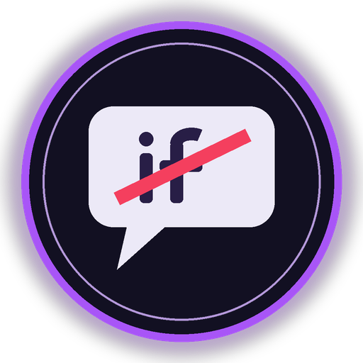

# SorryNotSorry v2

<p align="center"></p>

A GenLayer application for **unverified allegations and disputable response records**.
Validators assess whether a respondent's words take responsibility for the alleged
conduct. They do not establish whether that conduct happened. No money is held.

**Release status: v2 Project address configured; live application tests are pending.**
Project contract: [0x7079320d70566B02f208925C2aa366Eff870c567](https://explorer-studio.genlayer.com/address/0x7079320d70566B02f208925C2aa366Eff870c567).
The owner supplied an explorer screenshot showing deployment SUCCESS and Finalized.
The deployment transaction hash, deployed-source match, version readback and live
semantic results have not yet been independently verified. Historical deployment
addresses and evidence remain under `docs/history/`; they do not validate v2.

## What changed after review

| Concern | v2 behavior |
|---|---|
| Broken model output was counted as DEFLECTS | Unsupported JSON, unknown labels, catchable provider failures and explicit INCONCLUSIVE cause rollback before any writes. No answer, attempt, duplicate marker, closure or activity change. |
| Factual denial could be treated as misconduct | The rubric requires INCONCLUSIVE for factual denials. Every allegation remains UNVERIFIED. A separate deterministic dispute does not call AI. |
| Irreversible adverse record | The respondent can dispute facts or assessment, even after closure. Original history is retained, the objection is visible, and the record is removed from activity totals exactly once. |
| Sybil filings | UI and views explicitly disclose no Sybil resistance. Filing alone never increments closure totals. Pair limits are wallet limits, not person limits. |
| 200-character answers exceeded transport limits | Complaint: 120 UTF-8 bytes; answer: 160 UTF-8 bytes. Full encoded calldata is measured before signing. A canonical 64-character id plus a 160-byte answer encodes to 254 bytes with the pinned SDK. |

## State and uncertainty

Only the named respondent can answer. A valid OWNS_IT resolves the thread. A valid
DEFLECTS consumes one attempt; the third closes it as CLOSED_UNANSWERED. This legacy
state name means three assessed deflecting responses, not silence or proven wrongdoing.
The complainant can withdraw while OPEN. Exact whitespace-normalized answers that
received a valid judgment cannot be repeated on the same thread.

INCONCLUSIVE is an assessment failure/uncertainty outcome, **not a stored grievance
state**. The transaction rolls back with an explicit message and identical text can
be retried. Uncatchable VM errors or failed consensus also must not be described as
semantic verdicts. Leader/validator agreement is checked on canonical outcomes;
each validator independently assesses the input. No frontend classifier is used.

`dispute_grievance(id, kind)` accepts FACTS or ASSESSMENT. Each can be recorded once;
both become BOTH. It does not reopen the thread, erase answers, prove a denial, or
perform independent arbitration. An OPEN disputed thread can still receive responses,
but can never enter the undisputed activity totals. There is no admin override.

The public `get_standing` method is retained for API continuity. Its totals are
**undisputed response activity, not reputation**. They are mutable when disputed.
Respondents can remove their own record from aggregates without proving the dispute,
so neither disputed nor undisputed totals should be treated as misconduct ratings.

## Run and deploy

Node 22.18+ or 24 and Python 3.12 are used by the tooling.

```sh
npm ci
npm test
npm run build
npm run verify:source
npm run calldata
```

Deploy `contracts/NoIfApology.py` as a **new instance**, with no constructor arguments.
Do not upgrade the v1 deployment: storage and behavior changed. Keep the Project and
Intelligent Contract submission deployments separate. Confirm `get_limits()` returns
NoIfApology / 2.0.0 and the expected rubric hash. This package already configures the
Project address in `src/lib/config.ts` and `deployments.json`. The optional public
VITE_CONTRACT_ADDRESS environment variable overrides the address in config.ts; keep
an existing override aligned with this deployment. If absent, no new variable is
required. Commit the files and redeploy the frontend. `.env.example` is a template,
not an active Vercel setting. No private key belongs in frontend configuration.

The app blocks writes to a different version. Reads explicitly use the pinned SDK's
latest-nonfinal accepted-state variant. Success requires both applied consensus status
with successful execution and a matching state readback; accepted state is not finality.
Pending hashes are saved per deployment and prevent repeat writes across reloads.
After a reload, receipt recovery refreshes records but does not claim to have verified
the original postcondition without its prior state snapshot.

## Verification and limits

`TESTING.md` separates deterministic tests from required live semantic evidence.
`RUNTIME_EVIDENCE.md` tracks v2 evidence; historical v1 receipts are not v2 passes.
`SECURITY.md` records the trust limits. Source SHA-256 is in `SOURCE_SHA256.txt` and
the frontend verification view. An embedded hash labels the local source; it does
not independently attest that a deployed instance has that source.

Inputs are public. Do not upload sensitive personal allegations. Wallet ownership
is not real-world identity. Coordinated filings, collusion, prompt injection,
semantic misclassification, repeated attempts with paraphrases, and selective
disputes remain possible. No automated system here determines real-world liability.
